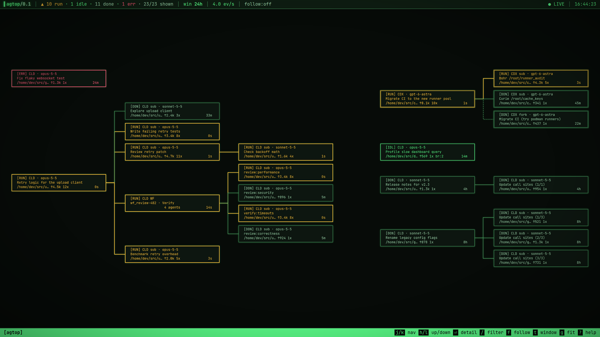
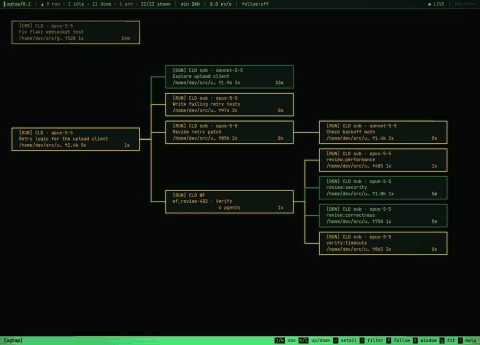
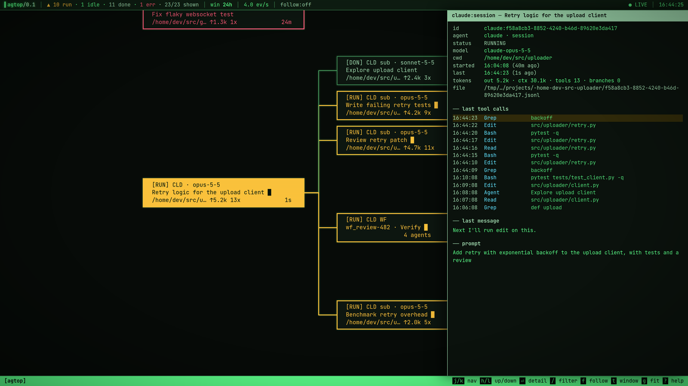
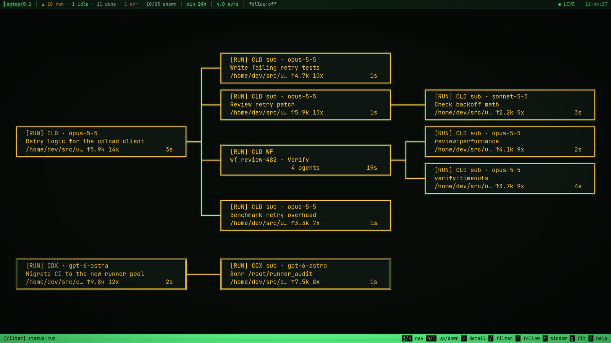
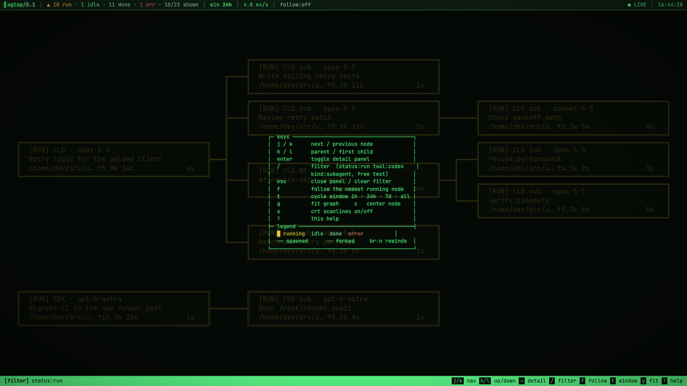
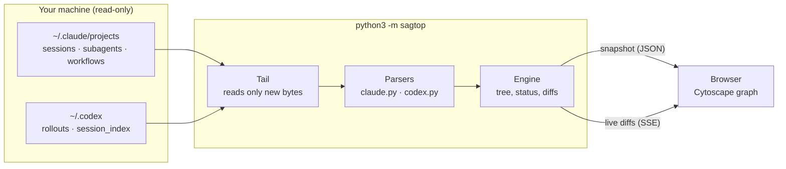

# ▌sagtop — Swarm Agent Top

**`top` for your coding agents.** A live graph of every Claude Code and Codex
session on your machine: each session, subagent, workflow and fork is a node,
edges show who spawned whom, and everything updates as the agents work.



- **Live.** New sessions and subagents appear within about a second; running nodes blink.
- **Whole tree.** Subagents, nested subagents, Workflow runs and their agents, Codex sub-threads and forks, all in one graph.
- **Zero setup.** Reads the transcripts Claude Code and Codex already write. No hooks, no config changes, never writes to them.
- **Zero dependencies.** Python standard library on the server; Cytoscape.js and the font are vendored.
- **Near-zero overhead.** Event-driven on Linux (inotify): ~0 % CPU while watching, ~34 MB of memory, updates on screen ~0.2 s after an agent writes. A day of history loads in under a second.

## Quick start

```bash
git clone https://github.com/CornelioP/sagtop.git
cd sagtop
python3 -m sagtop          # → http://127.0.0.1:7878
```

On a remote machine, forward the port from your laptop and open `http://localhost:7878`:

```bash
ssh -L 7878:localhost:7878 <host>
```

No sessions handy? `python3 -m sagtop --demo` runs it on invented sessions that keep changing.

## Watch it work

A subagent ("Benchmark retry overhead") is spawned while the page is open; it
attaches to its parent and the tree reflows:



Press <kbd>Enter</kbd> on any node for its details: model, tokens, the last 20
tool calls (newest flashes in), the last message and the original prompt.



Press <kbd>/</kbd> to filter. Matches keep their ancestors, so nothing floats
free of its tree. Here, `status:run`:



## Reading the graph

| You see | It means |
|---|---|
| amber box, blinking `█` | **running**: written in the last 10 s, or mid-turn and written in the last 2 min |
| bright green | **idle**: quiet, but active in the last 30 min |
| pale green | **done**: older, or a subagent/workflow that reported completion |
| red | **error**: the last assistant message was an API error |
| `CLD` / `CDX`, double border | Claude Code / Codex |
| `sub`, `WF`, `fork` | subagent, workflow run, forked thread |
| solid / dashed edge | spawned / forked |
| `↑5.2k 13x` | output tokens, tool calls |
| `br:2` | rewinds or edits inside the conversation |
| `!` | unparsable lines or a parser error; details in the panel |

## Keys

| Key | Action | Key | Action |
|---|---|---|---|
| <kbd>j</kbd> <kbd>k</kbd> | next / previous node | <kbd>f</kbd> | follow the newest running node |
| <kbd>h</kbd> <kbd>l</kbd> | parent / first child | <kbd>t</kbd> | time window: 1h · 24h · 7d · all |
| <kbd>Enter</kbd> | detail panel | <kbd>g</kbd> | fit everything |
| <kbd>/</kbd> | filter | <kbd>c</kbd> | center selected node |
| <kbd>Esc</kbd> | close panel / clear filter | <kbd>s</kbd> | CRT scanlines on/off |
| <kbd>?</kbd> | help | | |

Filter syntax: free text (title, folder, model, id) plus `status:`, `tool:`,
`kind:` and `model:` prefixes, e.g. `kind:workflow opus`.



## Options

| Flag | Default | |
|---|---|---|
| `--port` | `7878` | |
| `--host` | `127.0.0.1` | keep it local: transcripts contain everything you typed |
| `--window` | `24h` | `1h`, `24h`, `7d`, `all`; also <kbd>t</kbd> in the UI |
| `--claude-dir` | `$CLAUDE_CONFIG_DIR/projects`, else `~/.claude/projects` | |
| `--codex-dir` | `$CODEX_HOME`, else `~/.codex` | |
| `--demo` | off | invented sessions instead of yours |

The time window is server-wide: changing it in one tab changes it for all.

## How it works



1. **Watch.** On Linux, inotify reports which files changed; the engine touches only
   those and sleeps until the next event or the next moment a status flips by time
   (running → idle → done). A full sweep every 60 s, and after any event-queue
   overflow, is the safety net. Elsewhere (macOS, BSD) it polls once a second.
   Only files active within the time window are read, plus the ancestors of anything shown.
2. **Tail** each file from where it stopped, in 1 MB batches. Half-written lines wait
   for the rest; records sagtop never reads (API request echoes, tool results, Codex
   model I/O) are recognised from their first bytes and never JSON-decoded. Truncated
   or replaced files are re-read from the start. A backlog over 1 GB (e.g. the `all`
   window) is split across 4 worker processes running the same parser.
3. **Fold** records into one node per transcript, then publish only what changed,
   each change numbered. A browser that falls too far behind reloads the snapshot.
4. **Isolate failures.** A file that won't parse marks its own node and never stops the loop.

### Where the tree comes from

| Source | Becomes |
|---|---|
| `projects/<proj>/<sid>.jsonl` | Claude session; title from `ai-title`, else first prompt |
| `<sid>/subagents/agent-<id>.jsonl` + `.meta.json` | subagent; nested via `parentAgentId`, fork via `isFork`, done via `finished` |
| `<sid>/subagents/workflows/wf_<id>/` | Workflow run: progress from `journal.jsonl`, name and totals from `<sid>/workflows/wf_<id>.json` |
| `~/.codex/sessions/**/rollout-*.jsonl` | Codex thread; parent from `parent_thread_id`, fork from `forked_from_id`, name from `session_index.jsonl` |

Claude Code does not record which session a resumed or forked *session* came from,
so those appear as separate roots.

## Overhead

Measured with `bench/overhead.py` (3 runs × 30 s, median) on 16 cores against real
history: ~1,400 transcripts, 2.6 GB.

| | 24h window (145 nodes) | all history (1,400 nodes) |
|---|---|---|
| ready (first snapshot) | 0.94 s | 1.9 s |
| CPU while watching | 0.03 % | 0.13 % |
| memory (RSS) | 34 MB | 58 MB |
| browser update after a write | ~0.2 s | ~0.2 s |

Total CPU for one cold load (`bench/cold_cpu.py`): 0.9 s for 24h, 6.4 s for all history
(the latter spread over 4 workers).

## Development

```
sagtop/
  __main__.py   CLI, defaults from CLAUDE_CONFIG_DIR / CODEX_HOME
  tail.py       incremental JSONL reader
  claude.py     Claude sessions, subagents, workflows
  codex.py      Codex rollouts
  watch.py      inotify via ctypes (Linux); engine polls without it
  engine.py     change tracking, time window, diffs, event buffer, parallel cold load
  server.py     HTTP: static files, /api/snapshot, /api/node/<id>, /api/events (SSE)
  demo.py       invented, self-updating session tree (--demo)
  static/       index.html · app.js · style.css · vendor/
tests/          unittest; synthetic fixtures only
bench/          overhead.py (ready time, CPU, RSS) · cold_cpu.py (CPU incl. workers)
```

```bash
python3 -m unittest discover -s tests -t .
```

The tests cover the tailer's edge cases (partial lines, truncation, rotation), both
parsers, the time window and ancestor rules, failure isolation, and an end-to-end
check that an appended line reaches a browser stream in under 2 s.
